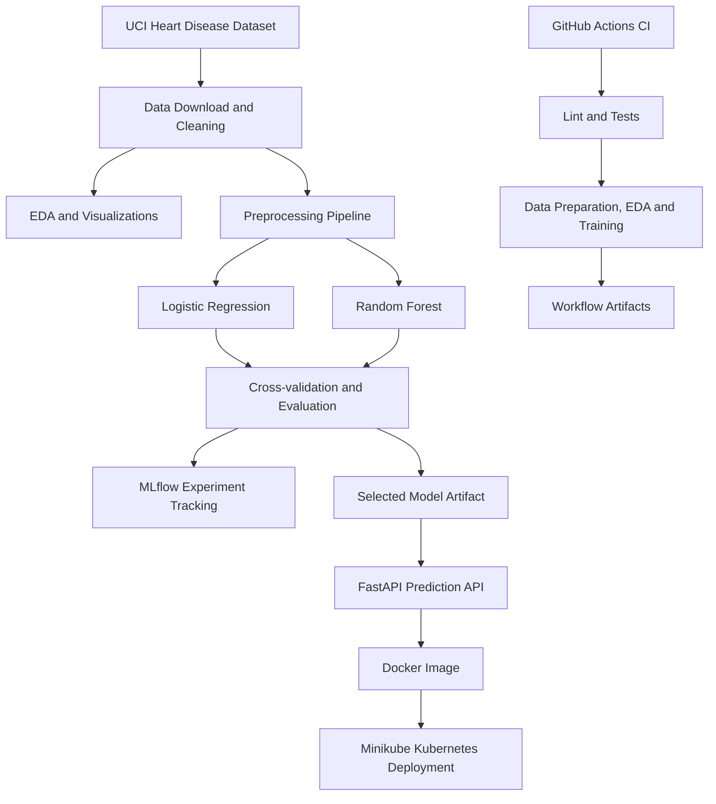

# MLOps Assignment 01 — Heart Disease Classification

## 1. Project Overview

This project implements an end-to-end machine learning workflow for binary heart-disease classification using the Cleveland subset of the UCI Heart Disease dataset. It demonstrates data preparation, exploratory data analysis, model evaluation, MLflow experiment tracking, automated tests, CI, Docker packaging, and local Kubernetes deployment.

**Repository:** https://github.com/2025af05139-alt/heart-disease-mlops

**Disclaimer:** Educational demonstration only. This model is not clinically validated and must not be used for diagnosis or treatment decisions.

## 2. Architecture



## 3. Dataset and EDA

- Source: UCI Machine Learning Repository, Heart Disease dataset, ID 45.
- Dataset subset: Cleveland.
- Rows processed: 303.
- Columns: 14, including the target.
- Target distribution: 164 samples in class 0 and 139 in class 1.
- Missing predictor values were found in `ca` (4) and `thal` (2).

The target was converted to binary classification: original value 0 represents absence, while original values 1–4 represent presence of disease. Preprocessing is performed within the model pipeline to reduce train/test leakage.

EDA outputs include class balance, feature histograms, a correlation heatmap and a JSON summary.

Evidence:
- `screenshots/mlflow-experiments.png`
- EDA figures are stored in `reports/figures/`.

## 4. Model Development and Evaluation

Two classifiers were evaluated:
- Logistic Regression
- Random Forest

The evaluation used a stratified train/test split (242 training rows and 61 test rows) and five-fold stratified cross-validation. The selected model was Logistic Regression, based on mean cross-validation ROC-AUC.

| Metric | Logistic Regression | Random Forest |
|---|---:|---:|
| Mean CV ROC-AUC | 0.9025 | 0.8964 |
| Test accuracy | 0.8852 | 0.8689 |
| Test precision | 0.8387 | 0.8125 |
| Test recall | 0.9286 | 0.9286 |
| Test ROC-AUC | 0.9665 | 0.9491 |

These are recorded experimental results, not a guarantee of generalization or clinical performance.

## 5. Experiment Tracking and Packaging

MLflow was used to track training experiments, parameters, metrics and artifacts. The experiment is named `Heart Disease Classification`.

The selected scikit-learn preprocessing and model pipeline is saved at:

`artifacts/models/heart_disease_best_model.joblib`

Evaluation results are saved under `reports/`, including the model comparison CSV, JSON metrics and figures.

To open the local MLflow UI, run the project's documented MLflow server command from the README. The UI is local to the development machine and is not a public service.

## 6. API and Containerization

The FastAPI application is implemented in `src/api.py`.

| Endpoint | Purpose |
|---|---|
| `GET /` | Service information |
| `GET /health` | Service and model-loaded health check |
| `POST /predict` | Return a prediction and probability estimates |
| `GET /docs` | Interactive OpenAPI documentation |

The prediction response includes the predicted class, label, probability, model name and educational-use disclaimer.

The Docker image is `heart-disease-api:1.0`. The container exposes port 8000.

Rebuild and run locally:

```powershell
docker build -t heart-disease-api:1.0 .
docker run --rm -p 8000:8000 heart-disease-api:1.0
```

## 7. Kubernetes Deployment

The application was deployed locally using Minikube with Docker Desktop as the driver. Kubernetes resources are defined in `k8s/deployment.yaml` and `k8s/service.yaml`.

The verified deployment had:
- One desired API replica, ready and available.
- A running pod with zero restarts.
- A Kubernetes Service configured as `LoadBalancer`.
- A successful prediction request returning HTTP 200 through `http://127.0.0.1:8000`.

On this local Windows setup, the Minikube tunnel must remain running for the LoadBalancer address to be accessible.

Evidence:
- `screenshots/kubernetes-deployment.png`
- `screenshots/kubernetes-prediction.png`

## 8. CI/CD and Automated Testing

The GitHub Actions workflow is located at `.github/workflows/ci.yml`. It runs on pushes and pull requests targeting `main`, and supports manual triggering.

The workflow performs:
1. Dependency installation.
2. Ruff lint checks.
3. Pytest automated tests.
4. Dataset preparation.
5. EDA generation.
6. Model training and evaluation.
7. Upload of workflow artifacts, including test results and generated reports.

Local verification recorded seven passing tests and successful Ruff checks. Three GitHub Actions workflow runs were shown as successful in the captured evidence.

Evidence: `screenshots/github-actions.png`

Repository: https://github.com/2025af05139-alt/heart-disease-mlops/actions

## 9. Logging and Health Checks

The API emits request logs that include the HTTP method, path, response status and duration. Successful `/health` and `/predict` requests were observed in Kubernetes pod logs.

Kubernetes readiness and liveness probes use the `/health` endpoint to check application health.

Evidence: `screenshots/api-logs.png`

A dedicated Prometheus/Grafana monitoring dashboard is not included in the current implementation; the demonstrated monitoring consists of health probes and application request logs.

## 10. Reproducibility and Limitations

Dependencies are declared in `requirements.txt`. The model pipeline contains preprocessing and the estimator, and the training scripts generate evaluation outputs. Fixed random seeds are used for reproducibility.

Limitations:
- The model is educational and not clinically validated.
- The deployment is local to Minikube and is not a public cloud deployment.
- Local MLflow storage and the Minikube tunnel require the development environment to remain available.
- A full Prometheus/Grafana dashboard and automated production deployment are outside the current implementation.

## 11. Conclusion

This project demonstrates the main stages of an MLOps workflow: acquiring and preparing data, training and evaluating multiple models, tracking experiments, packaging the model behind an API, running automated checks, and deploying the service to local Kubernetes.

The repository includes the code, tests, deployment manifests, generated evaluation reports and screenshots supporting the demonstrated workflow.
